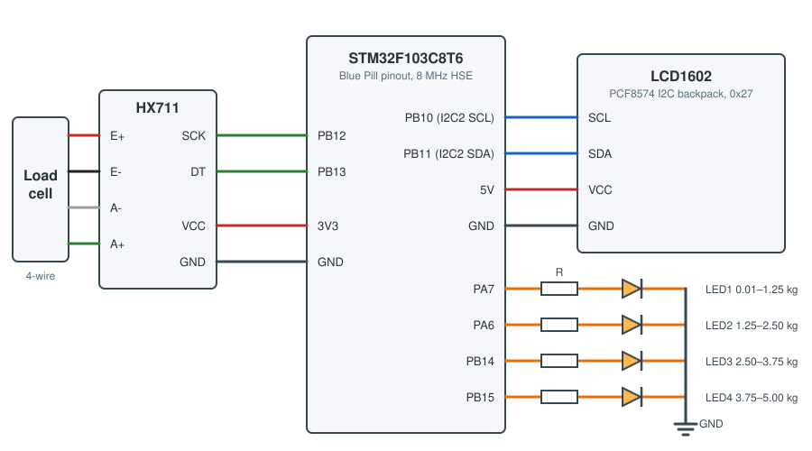

# Digital scale on STM32F103 (bare metal)

[](https://github.com/esbezborodov/scales_stm32/actions/workflows/build.yml)

Firmware for a 5 kg digital scale: a strain gauge load cell read through an HX711 ADC, weight
shown on a 16×2 LCD and on four LEDs, each LED standing for its own weight range.
Written directly against CMSIS registers, without HAL, CubeMX or printf: the release build is
about 4.5 KB of flash.

<!-- Photos of the assembled scale: docs/images/ -->

## How it works

- **Clock.** SYSCLK is 72 MHz from the PLL fed by the 8 MHz crystal. If the crystal does not
  start, the firmware falls back to HSI (64 MHz) instead of hanging.
- **HX711.** The two-wire interface is bit-banged with microsecond delays from the DWT cycle
  counter. Interrupts are masked while the 25 clock pulses are sent, because SCK held high for
  more than 60 µs powers the chip down. The 24-bit result is sign-extended to `int32_t`, and
  every wait has a timeout, so a disconnected sensor shows `Sensor error` instead of freezing.
- **Tare and calibration.** At power-up the empty scale is averaged over 16 conversions and taken
  as zero. Raw counts are converted to grams with integer math (64-bit intermediate, rounding
  half away from zero) using the sensitivity from [`config.h`](firmware/inc/config.h).
- **LCD.** HD44780 in 4-bit mode behind a PCF8574 I2C expander. The I2C master driver works on
  registers with timeouts and releases a bus stuck by a slave (nine SCL pulses + STOP) at start-up.
  Weight is formatted without printf, e.g. `1.25 kg`.
- **LEDs.** Every LED covers one range: 0–1.25, 1.25–2.50, 2.50–3.75 and 3.75–5.00 kg. Readings
  within 10 g of zero light nothing, above 5 kg the LCD shows `Overload` and all LEDs blink.
  The bounds are a table in `config.h`.

## Hardware

| Part | Notes |
| --- | --- |
| STM32F103C8T6 board | custom board with the Blue Pill pinout and an 8 MHz crystal; a Blue Pill works as is |
| HX711 module | channel A, gain 128, 10 samples per second |
| Load cell | 4-wire strain gauge, up to 5 kg |
| LCD1602 with PCF8574 backpack | I2C address `0x27` |
| 4 LEDs with series resistors | active high |
| ST-LINK/V2 | SWD programming and debugging |

### Wiring



| Signal | MCU pin |
| --- | --- |
| HX711 SCK | PB12 |
| HX711 DT | PB13 |
| HX711 VCC / GND | 3V3 / GND |
| LCD SCL | PB10 (I2C2) |
| LCD SDA | PB11 (I2C2) |
| LCD VCC / GND | 5V / GND |
| LED 1 … 4 | PA7, PA6, PB14, PB15 |

The pin assignment is in [`firmware/boards/`](firmware/boards): `custom` for the PCB (default) and
`bluepill` for the breadboard prototype, selected with the `BOARD` CMake variable or a preset.
PB10 and PB11 are 5 V tolerant, so the LCD backpack pull-ups may go to 5 V.

## Build, flash and test

Requirements: `arm-none-eabi-gcc`, CMake ≥ 3.20, Ninja and OpenOCD; a native C compiler for the
unit tests.

```sh
# macOS
brew install --cask gcc-arm-embedded
brew install cmake ninja openocd

# Debian / Ubuntu
sudo apt install gcc-arm-none-eabi libnewlib-arm-none-eabi cmake ninja-build openocd
```

```sh
./build.sh            # Debug build   → build/debug/scale_firmware.{elf,bin,hex}
./build.sh release    # Release build → build/release/
./flash.sh            # build and flash through an ST-LINK
./flash.sh bluepill-release   # the same for the Blue Pill prototype
./test.sh             # host unit tests: gram conversion, formatting, LED ranges
```

The scripts wrap the CMake presets, so `cmake --preset debug` and `cmake --build --preset debug`
work the same way from CLion or VS Code (tasks and a Cortex-Debug launch config are included).

## Calibration

1. Set `SCALE_CALIBRATION_MODE` to `1` in [`config.h`](firmware/inc/config.h) and flash.
2. Power the scale up empty and wait for the tare to finish.
3. Put a known mass on it. The first LCD row shows `raw <counts>`.
4. Set `SCALE_COUNTS_PER_KG` to `counts / mass_in_kg`, set the mode back to `0` and flash again.

## Project layout

```
firmware/
  common/       reusable drivers, one folder per module:
                delay (SysTick + DWT), gpio_drv, i2c_drv, hx711_drv, lcd_drv
  inc/  src/    application: board pins, config, scale math, display, LED indicator
  platform/     startup code, linker script, clock setup, CMSIS system file
  tests/        host unit tests (CTest)
  debug/        OpenOCD config and SVD file for debugging
vendor/CMSIS/   CMSIS core and STM32F1 device headers
cmake/          arm-none-eabi toolchain file
docs/           images for this README
```

## Background

Built in 2025 as a course assignment and later reworked: CubeMX and HAL replaced with own
register-level drivers, CMake build, unit tests and CI.

## License

The project code is released under the [MIT License](LICENSE).
CMSIS headers in `vendor/` (Arm, Apache-2.0) and the startup and system files in
`firmware/platform/` (STMicroelectronics, BSD-3-Clause) keep their original licenses.
