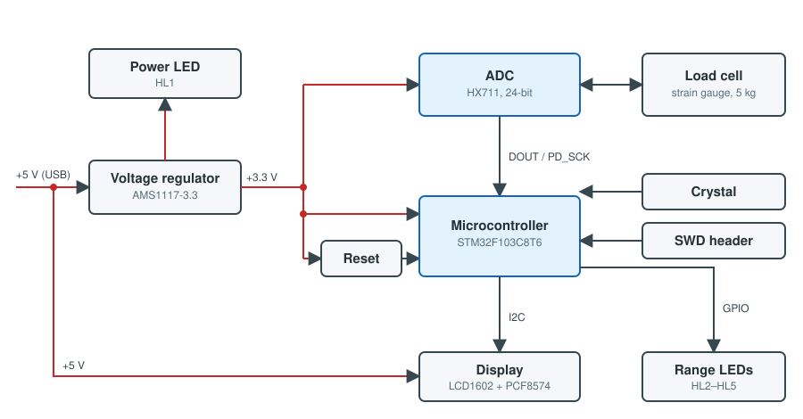
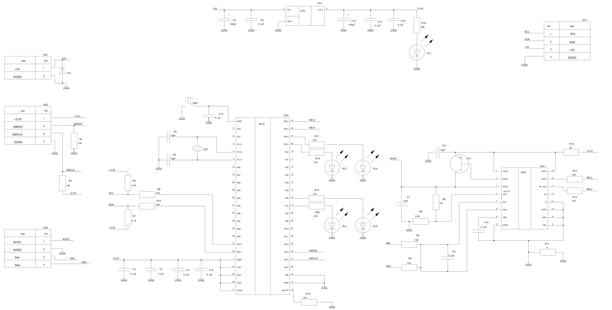
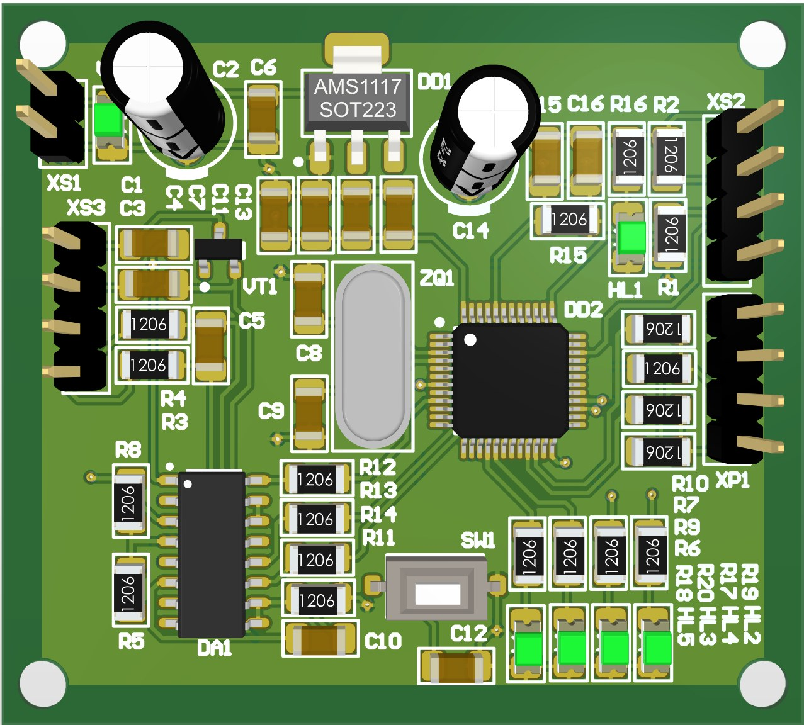
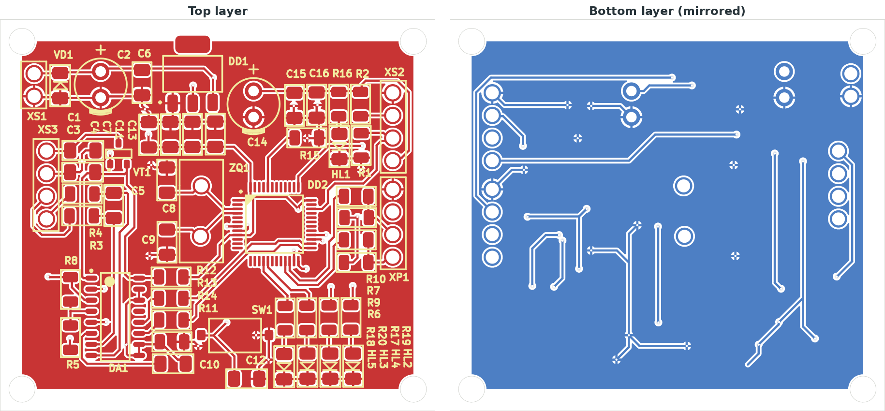

# Hardware

A two-layer 50 × 45 mm PCB designed in Altium Designer 23 as a course project (2025) and
manufactured by NextPCB. The original documentation was drawn to GOST (ESKD) standards; the
drawings here are redrawn from the Altium project with English labels and without the drawing
frame.

## Block diagram

- **Power.** +5 V from USB comes in through XS1 (VD1 is a Schottky protection diode) and feeds
  the display. An AMS1117-3.3 regulator (DD1) supplies the MCU and the ADC, HL1 shows power.
- **ADC.** HX711 (DA1) on the board. VT1 with the divider R5/R8 forms the HX711 analog supply
  regulator; its output AVDD also excites the load cell bridge connected to XS3.
- **MCU.** STM32F103C8T6 (DD2) with a reset button SW1, an SWD header XS2 and BOOT0 pulled low
  by R15.
- **Display** on XP1: I2C with 4.7 kΩ pull-ups to 3.3 V (R6, R7) and 100 Ω series resistors
  (R9, R10), powered from 5 V.
- **Range LEDs** HL2–HL5 with 270 Ω resistors, driven high by the MCU.

## Schematic

Click the drawing to open the full-size SVG; it is also available as a [PDF](schematic.pdf).

## PCB

Two layers, ground pour on both sides, 1206 SMD passives, four mounting holes. The 3D view is
rendered in Altium Designer; the copper layers are exported from the Altium project with KiCad.

## Connectors

| Connector | Pin 1 | Pin 2 | Pin 3 | Pin 4 |
| --- | --- | --- | --- | --- |
| XS1 — power | +5 V | GND | | |
| XS2 — SWD | +3.3 V | SWDIO | SWCLK | GND |
| XS3 — load cell | AVDD (E+) | AGND (E−) | INA− (A−) | INA+ (A+) |
| XP1 — display | SCL | SDA | +5 V | GND |

## Known issues (rev. 1)

- **The crystal is on the wrong pins.** ZQ1 (8 MHz) is connected to PC14/PC15 (pins 3 and 4),
  which are the 32.768 kHz LSE oscillator pins, instead of OSC_IN/OSC_OUT (PD0/PD1, pins 5
  and 6). The external clock cannot be used, so the firmware runs this board from the internal
  HSI oscillator at 64 MHz (`BOARD_HAS_HSE 0` in
  [`firmware/boards/custom/board.h`](../firmware/boards/custom/board.h)); that is accurate
  enough for the HX711 and I2C timing. Rev. 2 should move ZQ1, C8 and C9 to pins 5 and 6.
- **LEDs are not placed in signal order.** Left to right the board has HL5 (PA6), HL3 (PA7),
  HL4 (PB14) and HL2 (PB15). The custom board header maps the ranges so that they still light
  up from left to right.

## Bill of materials

| Ref | Qty | Part | Description |
| --- | --- | --- | --- |
| DD2 | 1 | STM32F103C8T6 (STMicroelectronics) | Cortex-M3 MCU, 72 MHz, LQFP48 |
| DA1 | 1 | HX711 (Avia Semiconductor) | 24-bit ADC for bridge sensors, 2.6–5.5 V, SOP-16 |
| DD1 | 1 | AMS1117-3.3 (Advanced Monolithic Systems) | 3.3 V LDO, 800 mA, SOT-223 |
| VT1 | 1 | BC807-25 (Nexperia) | PNP transistor, 45 V, 0.5 A, SOT-23 |
| VD1 | 1 | SD1206S020S1R0 (KYOCERA AVX) | Schottky diode, 20 V, 1 A |
| ZQ1 | 1 | 8.00M-HC49-S (YIC) | 8 MHz crystal, 20 pF, ±30 ppm |
| HL1 | 1 | GNL-1206EC (G-nor) | red LED, 635 nm, 1206 |
| HL2–HL5 | 4 | GNL-1206PGC (G-nor) | green LED, 525 nm, 1206 |
| C1, C3 | 2 | GRM31CR61A106KA01L (Murata) | 10 µF, 10 V, ±10 %, 1206 |
| C2, C14 | 2 | JRB1A101M020005 (JB Capacitors) | 100 µF, 10 V, ±20 %, electrolytic |
| C4–C7, C10–C13, C15, C16 | 10 | GRM31CR72E104K (Murata) | 0.1 µF, 250 V, ±10 %, 1206 |
| C8, C9 | 2 | C1206C130F1HACTU (KEMET) | 13 pF, 100 V, ±1 %, 1206 |
| R1, R2, R8, R15 | 4 | RI1206L103JT (Hottech) | 10 kΩ, 0.125 W, ±5 %, 1206 |
| R3, R4, R9, R10, R13, R14 | 6 | RC1206FR-07100RL (Yageo) | 100 Ω, 0.25 W, ±1 %, 1206 |
| R5 | 1 | RC1206FR-076K8L (Yageo) | 6.8 kΩ, 0.25 W, ±1 %, 1206 |
| R6, R7 | 2 | RAT064701FTP (Yageo) | 4.7 kΩ, 0.25 W, ±1 %, 1206 |
| R11 | 1 | RC0805JR-070RL (Yageo) | 0 Ω jumper, 0805 |
| R12 | 1 | RC1206FR-0720RL (Yageo) | 20 Ω, 0.25 W, ±1 %, 1206 |
| R16 | 1 | RC1206FR-07390RL (Yageo) | 390 Ω, 0.25 W, ±1 %, 1206 |
| R17–R20 | 4 | RC1206JR-07270RL (Yageo) | 270 Ω, 0.25 W, ±5 %, 1206 |
| SW1 | 1 | IT-1181A (Ruichi) | tactile switch, 6 × 3 × 2.5 mm |
| XS1 | 1 | PLS-2 (Connfly) | 2-pin header, 2.54 mm |
| XS2, XS3, XP1 | 3 | PLS-4 (Connfly) | 4-pin header, 2.54 mm |
